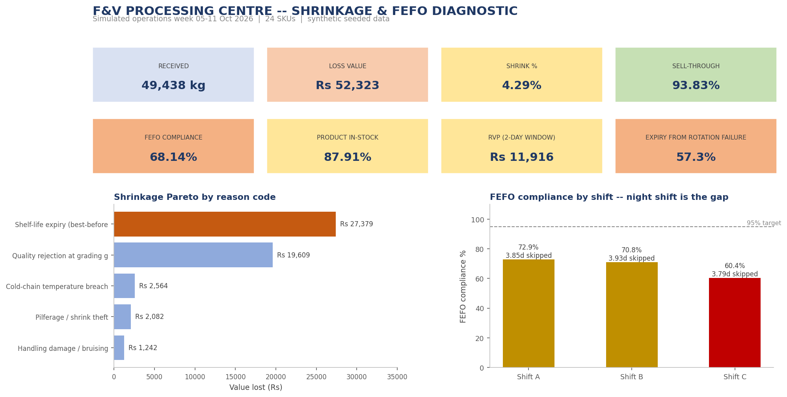
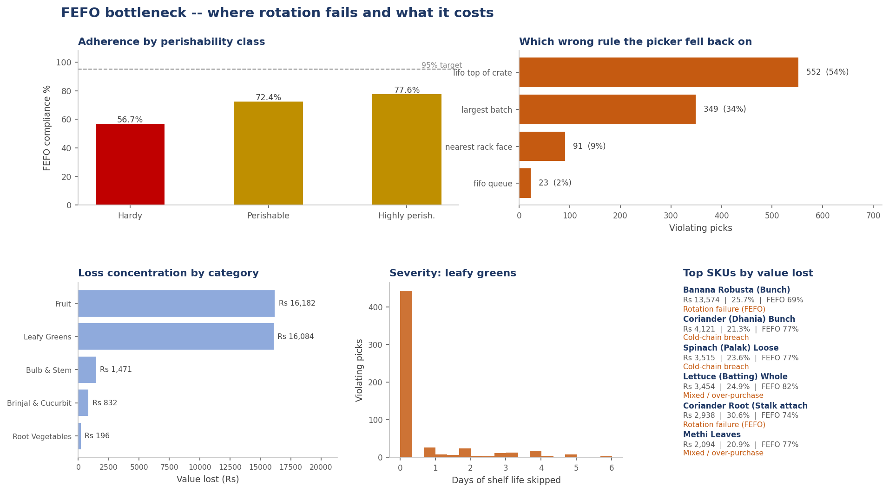
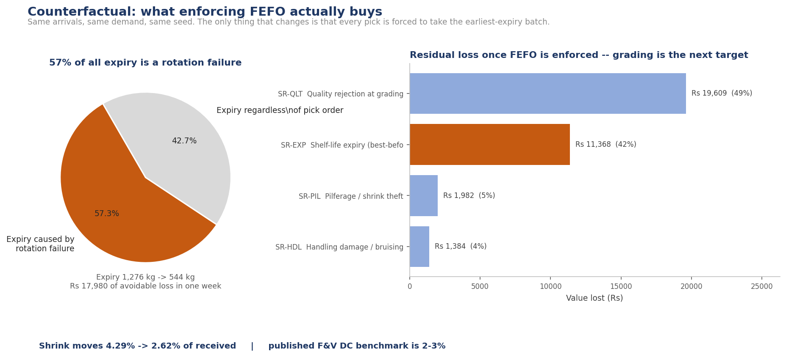
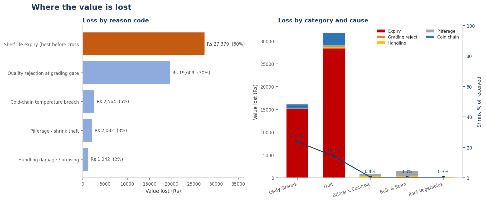

# F&V Supply Chain & Shrinkage Dashboard

**A First-Expired-First-Out (FEFO) bottleneck diagnostic for a fresh-produce processing centre, built as a live Power Query + PivotTable workbook over a simulated operations week.**

The question this project answers is not "how much did we lose" — that is a
number anyone can produce. It asks **why**, and then proves the answer by
re-running the same week with the suspected cause removed.



---

## Start here

**The workbook is already built and committed.** Download
[`fv_shrinkage_dashboard.xlsx`](fv_shrinkage_dashboard.xlsx) from this repo and
open it — you get 4 live PivotTables, 7 embedded Power Query definitions, and a
data dictionary, with no setup at all.

<details>
<summary>If you would rather rebuild it from source</summary>

```bash
pip install -r requirements.txt          # Python 3.9+; Excel build also needs Windows
python scripts/generate_data.py          # simulate the week      -> data/raw/
python scripts/analyze.py                # KPIs + counterfactual  -> data/processed/, reports/
python scripts/make_screenshots.py       # dashboard views        -> docs/screenshots/
python scripts/build_workbook.py         # assemble the .xlsx     -> fv_shrinkage_dashboard.xlsx
```

</details>

**Platform note:** the first three commands run on any OS. `build_workbook.py`
needs **Windows + desktop Excel**, because it drives Excel through COM to
create the PivotTables. On macOS or Linux it will fail at stage 2 with a COM
error — that is the only script here with a platform requirement, and the
committed workbook exists precisely so you do not have to run it.

---

## Executive summary

A regional processing centre received **49,438 kg** of fresh produce across
**22 SKUs** and **197 lots** in the week of 5–11 October 2026, at a landed
value of **₹15,01,208**. It wrote off **2,119 kg worth ₹52,323 — 4.29% of
receipts**, against a published F&V distribution-centre benchmark of 2–3%.

Three findings, in order of what they are worth:

1. **FEFO rotation failure is the dominant loss driver, and it is
   measurable in isolation.** Compliance across 3,186 pick events was
   **68.14%**, and each violation skipped **3.85 days of shelf life** on
   average. Re-simulating the identical week with every pick forced
   FEFO-compliant — same arrivals, same demand, same seed, only the rotation
   behaviour changed — cut shelf-life expiry from **1,276 kg to 544 kg** and
   total shrink from **4.29% to 2.62%**. That is **₹17,980 of avoidable
   loss in a single week**, and **57.3% of all expiry is attributable to
   rotation failure alone**.

2. **The failure is behavioural and locatable, not general.** Of the
   violating picks, **54% were "top-of-rack" grabs** (the picker takes the
   crate that was loaded last) and **34% were largest-crate bias**. These are
   habits, which means they are trainable — a different finding from "human
   error". Compliance tracks supervision almost perfectly: Shift A (supervisor
   on floor) **72.9%**, Shift C (night) **60.4%**.

3. **Once rotation is fixed, the next target is upstream, not operational.**
   In the counterfactual run the loss profile inverts: grading rejection at
   the intake gate becomes the largest line at **₹19,609 (49%)**. That
   produce never entered marketable stock, so no amount of handling discipline
   inside the DC can recover it. The remedy is grading at the FPO, not at the
   gate.



---

## Why a counterfactual instead of a correlation

The obvious analysis — correlate a SKU's FEFO violation rate against its
expiry rate — is **wrong here, and the data shows why**. Across SKUs the
correlation is weakly *negative* (r ≈ −0.4), because the highest-violation
SKUs (potatoes, onions) have 30-day shelf lives and simply cannot expire
inside a one-week window, while the highest-expiry SKUs (leafy greens) are
picked hard enough that compliance is already high.

Reporting that correlation would have produced the confident and entirely
wrong conclusion that rotation is *not* the problem. The counterfactual
sidesteps the confound because it holds shelf life, arrivals, demand and
every other loss source constant and varies only the rotation behaviour. The
effect is then attributable by construction rather than inferred.



---

## The dashboard

`fv_shrinkage_dashboard.xlsx` — four live PivotTables, two charts, seven
embedded Power Query definitions, and a data dictionary.

| Sheet | What it answers |
| --- | --- |
| `Dashboard` | KPI cards, shrinkage Pareto, FEFO compliance by shift, read-me-first notes |
| `PT1_Category_Shrinkage` | Rupee loss by category × reason code |
| `PT2_FEFO_Compliance` | Rotation adherence by category × storage zone, with mean shelf life skipped |
| `PT3_Daily_RVP_Trend` | Daily receipts, sell-through and inventory value at risk |
| `PT4_Bottleneck_SKUs` | Per-SKU loss ranked **by rupee value**, with the primary driver attributed |
| `Raw_Batches`, `FEFO_Pick_Log` | The two source ledgers |
| `PQ_*` | Materialised Power Query outputs — what the PivotTables bind to |
| `Data_Dictionary` | Every column, its meaning, and its grain |



**Two ranking decisions worth calling out**, because the naive version of
each produces the wrong operational instruction:

- **Bottlenecks are ranked by ₹ lost, not by % lost.** A 30% shrink rate on
  coriander is a fraction of the rupee value of a 4% rate on onions. A
  percentage-ranked list sends the category manager after the wrong SKUs.
- **FEFO compliance is shown against the *right* target.** Long-shelf-life
  stock does not need daily rotation; the 95% target belongs to the
  short-life lines. The workbook reports compliance alongside mean shelf life
  skipped, so severity is visible separately from frequency.

### Inventory Value at Risk

RVP is defined as the value of stock whose **remaining shelf life has fallen
inside a 2-day window**, weighted by proximity to expiry (1.0 at expiry, 0.5
at the window's outer edge). Weighting matters: an unweighted count treats a
batch one day from expiry as identical to one at the edge of the window.

This week: **₹11,916 at risk, 35.1% of closing stock value** — the exposure
the category team is carrying into the next trading week.

---

## Power Query

Seven M definitions live in `powerquery/`, and the same text is **embedded in
the workbook** so the transformation logic ships with the deliverable:

| Query | Purpose |
| --- | --- |
| `pq_Load_Batches` | Types every column by name, normalises the text-boolean flags, derives RVP / shrink% / sell-through |
| `pq_Load_Picks` | Derives rotation depth, severity band, and the named failure mode per pick |
| `pq_Agg_CategoryShrinkage` | Category × perishability loss matrix |
| `pq_Agg_FEFO_Compliance` | Compliance and mean shelf life skipped by category × zone × shift |
| `pq_Agg_DailyRVP` | Daily receipts, sell-through and RVP |
| `pq_Agg_SKUBottleneck` | Per-SKU loss ranked by value, with cause attributed |
| `pq_Load_Batches_FileVariant` | `Csv.Document` equivalent for use outside this workbook |

Two things the M does that are easy to get wrong and worth naming:

- **Every column is typed explicitly.** An untyped numeric column arrives as
  text in Excel and then sorts lexicographically — which is how `9.5` ends up
  ranked above `12` in a shrink column.
- **`TRUE`/`FALSE` are converted to real logicals.** The CSV writes them as
  text; pivot slicers silently match nothing against text booleans.

`docs/PowerQuery-Setup.md` has the one-click load path in the Excel ribbon.

---

## The data is simulated, and the simulation is not a label

`scripts/generate_data.py` runs an **hour-by-hour inventory simulation** over
168 measured hours (preceded by 72 hours of unmeasured warm-up, so the week
starts with carry-in stock at every stage of life rather than from zero).
Batches expire on their own best-before dates; any quantity still on hand at
the moment of expiry is written off. Nothing is labelled after the fact.

The one behavioural parameter that matters is the **buy-to-demand ratio**,
applied by perishability class:

| Class | Buy-to-demand | Effect |
| --- | --- | --- |
| Highly Perishable | 1.32 | Structural over-buy; expiry becomes the dominant loss |
| Perishable | 1.12 | Mild over-buy |
| Hardy | 1.08 | Near-balanced; stock turns as it lands |

Over-purchase is the **precondition** for FEFO to matter at all: with a ratio
of 1.0 there is never more than one batch on hand and therefore never a
rotation decision to get wrong.

FEFO compliance probability is depressed by five real, independent drags —
long shelf life, ambient storage, night shift, peak-volume pressure, and deep
rack position — each visible as its own cut in `PT2_FEFO_Compliance`.

Prices are anchored to publicly reported All-India figures for October 2026
(potato ₹12.00/kg mandi against ₹22.81 retail; tomato ₹30.95 against ₹42.74;
onion ₹45.00 against ₹53.53) and to published supply-chain loss benchmarks.

The generator is **seeded (`20261009`)**. Re-running it reproduces every
number in this README exactly.

---

## Rebuilding the workbook

The full pipeline, if you want to regenerate everything from seed:

```bash
python scripts/generate_data.py       # simulate the week          -> data/raw/
python scripts/analyze.py             # KPIs + counterfactual      -> data/processed/, reports/
python scripts/make_screenshots.py    # dashboard views            -> docs/screenshots/
python scripts/build_workbook.py      # assemble the .xlsx         -> fv_shrinkage_dashboard.xlsx
```

`build_workbook.py` runs in two stages because the two halves have opposite
performance profiles: **openpyxl** writes the ~80k data cells (seconds, and
it creates genuine Excel Table objects), then **Excel COM automation** adds
the PivotTables, charts and embedded queries (things only Excel can create).
Stage 2 requires Excel on Windows; stages 1–3 of the pipeline and the
screenshots work anywhere.

> **On loading Power Query headlessly.** The M is embedded with
> `Workbook.Queries.Add`, which is reliable through COM. *Loading* results
> into a worksheet needs a `WorkbookConnection` the COM interface will not
> build without a UI, and attempting it blocks indefinitely. So the queries
> ship embedded (auditable, one click from the Data ribbon) while the
> PivotTables bind to the `PQ_*` tables, which are produced by identical
> logic in `analyze.py` — which is why the workbook opens populated on any
> machine.

---

## Requirements

Python 3.9+ (developed and tested on 3.13). `pandas`, `numpy`, `openpyxl` and
`matplotlib` via `pip install -r requirements.txt`; `pywin32` only matters for
the workbook build, which additionally needs Windows + desktop Excel.

## Layout

```
data/raw/          simulated source ledgers (the only hand-off point)
data/processed/    enriched + aggregated tables, incl. the PQ_* outputs
reports/           KPI summary, findings JSON, shrinkage Pareto
powerquery/        the seven M queries
docs/screenshots/  dashboard views used by this README
scripts/           generate_data, analyze, make_screenshots, build_workbook
```

## Licence

MIT — see [LICENSE](LICENSE).

All data is synthetic. Prices reference publicly reported All-India mandi
and retail averages and the loss benchmarks reference published
supply-chain studies; neither is a proprietary dataset.

---

## Related projects

Three companion projects on the same problem — how much of the gap between
farm-gate cost and shelf price is recoverable in Indian F&V retail. They share
a commodity master, a lane (Bengaluru PC → dark store, 62 km), and a set of
grounded price and loss benchmarks. Each is a standalone repository; clone
only the one you want.

| project | question it answers | try it |
| --- | --- | --- |
| [transit-spoilage-anova](https://github.com/kv9515561091-ux/transit-spoilage-anova) | Which handling method extends shelf life? Finds that onions must **not** be chilled — worth ₹28.6 lakh/year on one lane | `pip install -r requirements.txt && python analysis/generate_experiment.py && python analysis/anova_analysis.py` |
| [mandi-margin-simulator](https://github.com/kv9515561091-ux/mandi-margin-simulator) | On any given day, is this line still worth buying? Node CLI, zero dependencies | `git clone https://github.com/kv9515561091-ux/mandi-margin-simulator.git && cd mandi-margin-simulator && node src/index.js simulate --days 30 --seed 99` |
| [fpo-sourcing-automation](https://github.com/kv9515561091-ux/fpo-sourcing-automation) | Can field data become a purchase-order line a buyer can act on? Apps Script; runs offline via a Python mirror | `python samples/generate_samples.py && python -m unittest discover -s samples` |

The connection worth noting: this project finds that **57.3% of expiry is a
picking-order problem**. The ANOVA project then asks whether better handling
would have helped instead — and concludes temperature, not handling
discipline, is the dominant lever. Read together they say the same loss needs
two different fixes, which is the opposite of what a single-dimension
investigation would have recommended.
